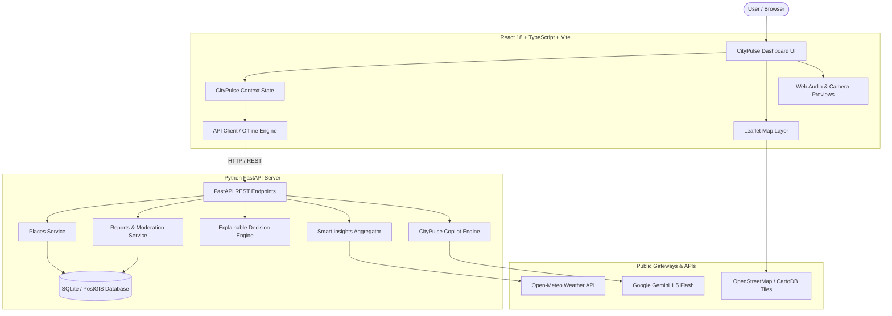

# CityPulse AI — Smart City Exploration & Intelligence Platform

[](https://vitejs.dev/)
[](https://tailwindcss.com/)
[](https://leafletjs.com/)
[](https://fastapi.tiangolo.com/)
[](LICENSE)

> **CityPulse AI** is an AI-powered smart city exploration and civic intelligence platform built for hackathons. It transforms scattered city information into clear, useful, and actionable insights — combining cultural discovery, local food, affordable stays, community-reported civic hazards, explainable multi-factor neighborhood comparisons, and an AI conversational Copilot.

---

## 🌟 Hackathon 3-Minute Demo Journey

1. **City Overview Dashboard**: Open the live dashboard to view Pune’s real-time urban telemetry: 14 curated landmarks, 6 active civic hazard reports, live satellite weather via Open-Meteo, traffic congestion metrics, and quick actions.
2. **Discover Hidden Gems**: Navigate to **Explore City**, search for `"Irani chai"` or `"Misal"`, filter by budget (`$`, `Free`) and wheelchair accessibility, and toggle between split list and synchronized Leaflet map markers.
3. **Safety Intelligence & Route Recommender**: Check the **Safety Intelligence** tab to view categorized civic hazards (potholes, dark stretches, waterlogging). Compare **Route A (Arterial, 100% lit)** vs **Route B (Shortcut with hazard reports)** with transparent justifications.
4. **Cultural Walking Trails**: Follow the **Old Pune Peshwa Heritage Trail** or **Deccan Colonial & Food Trail** with step-by-step pedestrian waypoints, historical timeline, and visiting hours.
5. **Compare Places Engine**: Select 2 to 4 places (e.g. *Shaniwar Wada* vs *Cafe Vaishali* vs *Vohuman Cafe*), adjust importance weights with live sliders, and inspect the mathematical score breakdown and missing-data indicators.
6. **Report an Issue**: Submit a civic report with title, category, severity, photo preview, Web Audio voice recording, and interactive map coordinate pinning.
7. **Ask CityPulse Copilot**: Launch the AI assistant to ask *"Plan a one-day heritage tour"* or *"Find affordable restaurants"* with grounded recommendations and follow-up chips.

---

## 🏗️ Architecture



---

## 📁 Project Structure

```
citypulse-ai/
├── README.md                      # Comprehensive project documentation
├── .env.example                   # Environment configuration template
├── standalone/
│   └── index.html                 # Instant-run zero-dependency single-file web MVP
├── backend/
│   ├── requirements.txt           # Python dependencies (FastAPI, uvicorn, pydantic)
│   ├── main.py                    # FastAPI application entrypoint & CORS config
│   ├── app/
│   │   ├── config.py              # Settings & environment variable loader
│   │   ├── database.py            # SQLite schema initialization & Haversine distance
│   │   ├── seed_data.py           # Curated seed dataset for Pune landmarks & reports
│   │   ├── schemas/schemas.py     # Pydantic data validation schemas
│   │   ├── services/
│   │   │   ├── places_service.py  # Place querying, filtering, and distance sorting
│   │   │   ├── reports_service.py # Report submission, feedback, and moderation
│   │   │   ├── compare_service.py # Explainable multi-factor comparison engine
│   │   │   ├── insights_service.py# Weather, traffic & recurrent pattern detection
│   │   │   └── ai_service.py      # Grounded Copilot assistant & Gemini LLM
│   │   └── api/
│   │       ├── health.py          # GET /api/health
│   │       ├── places.py          # GET /api/places, GET /api/places/:id
│   │       ├── reports.py         # GET /api/reports, POST /api/reports, feedback
│   │       ├── compare.py         # POST /api/compare
│   │       ├── insights.py        # GET /api/insights
│   │       └── ai.py              # POST /api/ai/recommend
│   └── tests/
│       └── test_api.py            # Automated API and algorithm unit tests
└── frontend/
    ├── package.json               # Node dependencies
    ├── vite.config.ts             # Vite configuration with proxy to backend
    ├── tailwind.config.js         # Dark navy, cyan, teal, violet palette
    ├── index.html                 # Main HTML entrypoint with Leaflet CSS
    └── src/
        ├── main.tsx               # React DOM bootstrap
        ├── App.tsx                # Application shell with routing
        ├── index.css              # Custom styling, dark mode scrollbars, map styles
        ├── types/index.ts         # TypeScript interfaces
        ├── services/
        │   ├── api.ts             # Offline-first API client with fallback simulation
        │   └── mockData.ts        # Client seed data for zero-latency execution
        ├── context/
        │   └── CityPulseContext.tsx # Central application state & action handlers
        ├── components/
        │   ├── layout/            # Sidebar, Header, MobileNav
        │   ├── map/CityMap.tsx    # Interactive Leaflet map with custom SVG markers
        │   └── common/            # Toast notifications, Modal, Badges
        └── pages/
            ├── OverviewDashboard.tsx  # Telemetry cards, quick actions, city map
            ├── ExploreCity.tsx        # Multi-filter search & place details
            ├── SafetyIntelligence.tsx # Incident map, route comparison, safety notes
            ├── HistoryCulture.tsx     # Heritage walking trails & Pune timeline
            ├── ComparePlaces.tsx      # Weighted sliders & side-by-side matrix
            ├── CommunityReports.tsx   # Issue submission, audio recorder, photo preview
            ├── SettingsDataSources.tsx# Telemetry, API keys & data provenance
            └── AICopilotModal.tsx     # Grounded natural-language conversational AI
```

---

## ⚡ Quick Start Options

### Option A: Instant Run (Zero Setup)
Simply open `standalone/index.html` in **any modern web browser**:
- Double click `standalone/index.html` or drag it into Chrome / Edge / Firefox.
- **Everything works instantly** without needing Node.js or Python installed!

---

### Option B: Full-Stack Vite + FastAPI Mode

#### 1. Start the Backend (Python FastAPI)
```bash
# Navigate to backend directory
cd backend

# Create virtual environment (optional)
python -m venv venv
# On Windows:
.\venv\Scripts\activate
# On Linux/macOS:
source venv/bin/activate

# Install dependencies
pip install -r requirements.txt

# Start backend server
python main.py
```
*Backend runs on `http://localhost:8000` (Interactive API docs at `http://localhost:8000/docs`).*

#### 2. Run Backend Tests
```bash
pytest tests/test_api.py -v
```

#### 3. Start the Frontend (Vite + React + TypeScript)
```bash
# Navigate to frontend directory
cd ../frontend

# Install dependencies
npm install

# Start development server
npm run dev
```
*Frontend runs on `http://localhost:5173` with automatic proxy to the backend API.*

---

## 📡 REST API Reference

| Method | Endpoint | Description |
|---|---|---|
| `GET` | `/api/health` | Returns service health, version, and active capabilities. |
| `GET` | `/api/places` | Lists places with query filters (`search`, `category`, `price_level`, `min_rating`, `accessible_only`, `lat`, `lng`, `sort_by`). |
| `GET` | `/api/places/{id}` | Retrieves detailed record for a specific landmark. |
| `GET` | `/api/reports` | Returns citizen incident reports with filters (`category`, `severity`, `status`). |
| `POST` | `/api/reports` | Submits a new community issue report with input validation. |
| `POST` | `/api/reports/{id}/feedback` | Registers community votes (`{"action": "helpful"}` or `{"action": "duplicate"}`). |
| `POST` | `/api/compare` | Runs multi-criteria decision comparison with user-adjustable weights. |
| `GET` | `/api/insights` | Aggregates weather telemetry, traffic congestion, and recurrent incident patterns. |
| `POST` | `/api/ai/recommend` | Natural-language query interface for CityPulse Copilot. |

---

## 🛡️ Responsible AI, Safety & Privacy Principles

1. **Reporting Bias Awareness**: Incident counts represent citizen-submitted reports, not official or exhaustive police crime records. Areas with fewer reports may simply experience less reporting activity.
2. **No Neighborhood Stigmatization**: CityPulse AI explicitly avoids declaring any neighborhood as categorically "safe" or "dangerous".
3. **Transparent Route Recommendations**: Route comparisons explain exact contributing factors (e.g. 100% sodium street lighting coverage, zero open road hazard reports) and explicitly note that algorithmic suggestions do not guarantee personal safety.
4. **Reporter Privacy**: All community submissions are anonymized (`Citizen #XXXX`). No phone numbers, email addresses, or private PII are publicly exposed.
5. **Civic Moderation Workflow**: Newly submitted reports enter a `Pending` state and are reviewed prior to receiving `Verified` status.
6. **Transparent Cleanliness Data**: When reliable municipal sensor telemetry is unavailable, the application labels criteria as **"Insufficient Data"** rather than fabricating synthetic scores.

---

## 🔑 External APIs & Demo Fallbacks

- **Weather**: Fetches live telemetry from Open-Meteo Satellite API. If offline, uses calibrated sensor cache with clearly labeled data mode badge.
- **Mapping**: OpenStreetMap / CartoDB tiles rendered via Leaflet.
- **AI Inference**: Supports Google Gemini 1.5 Flash when `GEMINI_API_KEY` is provided in `.env`. If no key is configured, runs the built-in deterministic reasoning engine with zero latency and full offline compatibility.
